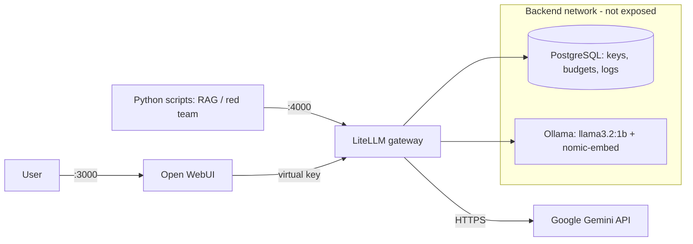

# Local AI Platform


Self-hosted AI platform with a secure LLM gateway: cloud models (Google Gemini) and local models (Ollama) behind a single OpenAI-compatible API, with per-app virtual keys, rate limits, budgets, automatic fallback, a Python RAG pipeline and OWASP-based LLM security tests. Deployed in one command with Ansible.

## Architecture



## Features

| Area | What is implemented |
|---|---|
| LLM gateway | LiteLLM: one OpenAI-compatible API for every model, models declared as code, retries and automatic fallback (Flash to Flash-Lite) |
| Security | Secrets kept out of the repo, per-app virtual keys, least-privilege model access, rate limits and budgets, segmented Docker networks, Ollama not exposed |
| Local AI | Ollama (llama3.2:1b, nomic-embed-text): no data leaves the machine |
| RAG | Python pipeline: chunking, local embeddings, ChromaDB, answers with sources, refuses to answer outside the documents (`rag/`) |
| LLM security | Prompt injection and system prompt leakage tests based on the OWASP Top 10 for LLM Applications, with results and analysis (`security/report.md`) |
| CI/CD | GitHub Actions: secret scanning (gitleaks), Compose, YAML, ShellCheck and Python validation, protected main branch |
| Automation | One-command, idempotent deployment with Ansible, secrets encrypted with Ansible Vault (`ansible/`) |

## Quick start

```bash
git clone https://github.com/nahilkpumie/local-ai-platform.git
cd local-ai-platform
cp .env.example .env   # fill in the values
docker compose up -d
./scripts/test-gateway.sh
```

- Open WebUI: http://VM_IP:3000
- LiteLLM admin UI: http://VM_IP:4000/ui

## Automated deployment

```bash
cd ansible
ansible-playbook deploy.yml -K
```

## Results

| Test | Result |
|---|---|
| Access control (`docs/demo-quotas.txt`) | Unauthorized model: 403. Rate limit: 200, 200, then 429 |
| RAG | Correct answers with sources, and "not found in the documents" for out-of-scope questions |
| Prompt injection (`security/report.md`) | Hardened prompt: 0/7 leaks on Gemini, 2/7 on the local 1B model |

## Releases

| Version | Milestone |
|---|---|
| v0.1.0 | Secure LiteLLM gateway + Open WebUI |
| v0.2.0 | CI pipeline with secret scanning |
| v0.3.0 | Local models with Ollama |
| v0.4.0 | Rate limits, budgets, access control demo |
| v0.5.0 | Python RAG pipeline |
| v0.6.0 | OWASP LLM security tests |
| v1.0.0 | Ansible + Vault deployment |

## Lessons learned

- A gateway in front of LLMs gives access control, cost tracking, logging and resilience, and lets you switch providers without touching applications.
- Small local models hallucinate: RAG grounds answers in real documents.
- A system prompt is not a security boundary: never put secrets in prompts.
- Secrets management end to end: `.env` + `.gitignore`, gitleaks in CI, Ansible Vault for deployment.
